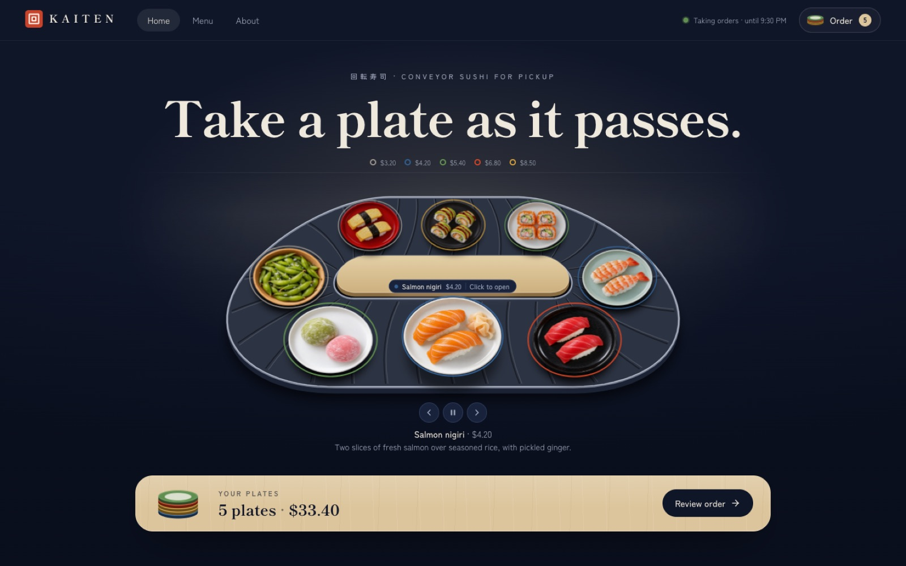
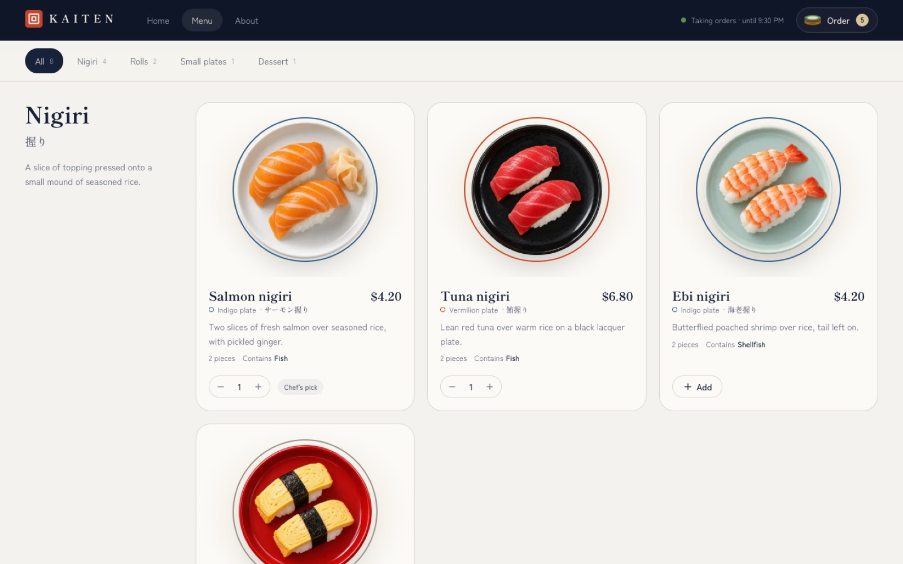
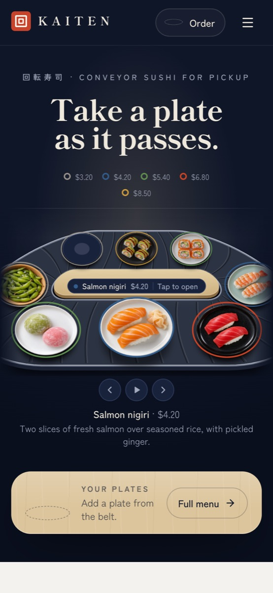
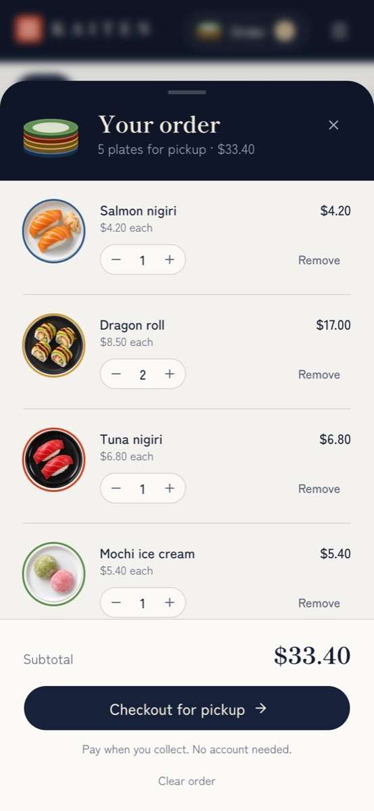

# KAITEN: conveyor-belt sushi storefront

A premium storefront for a conveyor-belt sushi restaurant, built with Next.js around an interactive sushi belt. Guests watch the plates go round, lift one for a closer look, and stack the plates they want, just as at a real kaiten counter. They order for pickup and pay at the counter, and the owner runs everything from a private admin.

**Live demo: [kaiten-sushi-store.vercel.app](https://kaiten-sushi-store.vercel.app)** · **Admin demo: [/demo/admin](https://kaiten-sushi-store.vercel.app/demo/admin)**



| The menu | On a phone | Your order |
| --- | --- | --- |
|  |  |  |

What's inside:
- **The storefront:** the interactive belt (drag, flick, hover, tap, keyboard, reduced motion), a menu with categories and allergens, and an order saved in the browser and drawn as a stack of plates.
- **Pickup ordering:** guests give a name and phone number and pay when they collect. The database prices every order; the browser can't.
- **An admin for the owner:** orders and their status, dishes and photos, plate prices, categories, opening hours and a pause switch.
- **Plate-colour pricing:** each plate colour has one price, so the belt, menu, order and receipts always agree.

**It runs with no accounts at all.** Without Supabase, KAITEN is a demo store with a demo admin: everything works except real ordering.

## 1. Try it on your computer (2 minutes, no accounts)

You need [Node.js 22](https://nodejs.org) or newer.

```bash
npm install
npm run dev
```

Open http://localhost:3000. You get the full storefront with eight demo dishes, in demo mode: the belt, menu and plate stack all work, and ordering is turned off.

Open http://localhost:3000/demo/admin for the **demo admin**: the same dashboard as the real one, running a sample restaurant with sample orders. Change a price, mark a dish sold out or move an order along, and the demo store follows. Everything stays in your own browser; **Reset demo** puts it back.

## 2. Make it a real store with Supabase (about 15 minutes)

Supabase holds your menu, opening hours and orders, and signs in your admin. The free plan is enough. You only need the website, no command line.

1. **Create a project** at [supabase.com](https://supabase.com). Choose a region near your restaurant and save the database password somewhere safe (KAITEN doesn't need it).
2. **Create the tables, security rules and starting menu.** Open **SQL Editor**, click **New query**, paste the whole contents of each file below, and click **Run**. Do them one at a time, in this order:
   1. `supabase/migrations/20261102200000_kaiten_schema.sql`: tables, security rules, ordering functions and the `dish-images` photo bucket
   2. `supabase/migrations/20261102200100_kaiten_seed.sql`: five plate colours, four categories, eight dishes and opening hours
   3. `supabase/migrations/20261102200200_kaiten_private_helpers.sql`: keeps an internal helper out of the public API

   Run each file once. Each one should finish with "Success. No rows returned".
3. **Check the photo bucket.** Under **Storage** you should see a public bucket called `dish-images`. The first file created it and its upload rules; there is nothing to set up by hand.
4. **Turn off public sign-ups.** In **Authentication → Sign In / Providers**, turn off **Allow new users to sign up**. KAITEN has no customer accounts; only you sign in.
5. **Create your admin account.**
   1. In **Authentication → Users**, click **Add user → Create new user**. Enter your email and a strong password, and tick **Auto Confirm User**.
   2. In the **SQL Editor**, run this with your email:

      ```sql
      insert into public.admin_users (user_id) select id from auth.users where email = 'you@example.com';
      ```
6. **Copy your keys.** Click **Connect** at the top of the dashboard (or open **Project Settings → API Keys**). You need the **Project URL** and the **publishable** key (`sb_publishable_…`). Never copy the secret key into the store.
7. **Point KAITEN at your project.** Copy `.env.example` to a new file called `.env.local` and fill it in:

   ```bash
   KAITEN_MODE=live
   NEXT_PUBLIC_SUPABASE_URL=https://your-project.supabase.co
   NEXT_PUBLIC_SUPABASE_PUBLISHABLE_KEY=sb_publishable_...
   ```

   Stop `npm run dev` and start it again.
8. **Sign in at http://localhost:3000/admin.** Open **Restaurant** and set your **time zone** first (it decides when you're open), then your name, pickup address, phone and opening hours.
9. **Place a test order** from the storefront, find it under **Orders**, and move it to *Preparing*. The guest's confirmation page follows along.

`.env.local` stays on your computer; Git ignores it. The store uses only the publishable key, and every table is protected by row-level security.

## 3. Put it online with Hostinger

KAITEN is a standard Next.js app, so it needs a **Node.js web app**, not static hosting.

1. Create a repository from this template on GitHub (**Use this template**).
2. In Hostinger's hPanel, add a **Node.js web app** and connect that repository.
3. Choose **Node.js 22**, build command `npm run build`, start command `npm start`.
4. Add the three settings from step 7 as **environment variables before the first build**. They are built into the site, so after changing one, rebuild.
5. Deploy, connect your domain, and turn on SSL. Then check that `/admin` signs in and a test order arrives.

More detail, including the public demo and other hosts: [docs/DEPLOY.md](docs/DEPLOY.md).

## The public demo

The demo build is a locked showcase you can host anywhere:
- the belt, menu, dish details, plate stack and order work as usual;
- `/demo/admin` is a demo of the admin, with sample data kept in each visitor's browser (checkout can send the cart there as a sample order);
- ordering is off, no guest details are asked for, and the real `/admin` is a 404;
- it never contacts Supabase, even if Supabase settings are present.

```bash
npm run build:demo
npm run start:demo   # http://localhost:3000
```

The live demo above is this build on Vercel ([docs/DEPLOY.md](docs/DEPLOY.md#vercel-public-demo)).

## Running the restaurant

Everything is in `/admin`:

| Page | What you do there |
| --- | --- |
| **Orders** | See new pickup orders (the page checks every 20 seconds), call the guest, and move each order from *New* to *Preparing*, *Ready* and *Collected*, or cancel it. |
| **Menu** | Mark a dish sold out for today, hide it, or edit it: name, description, allergens, category, plate colour and photo. |
| **Plates & prices** | Set the price and colour of each of the five plates. Every dish on that plate, the belt's colour key and guests' orders follow. |
| **Categories** | Rename, reorder, add or remove menu sections. |
| **Restaurant** | Name, pickup details, preparation time, time zone, opening hours, and the switch that pauses new orders. |

The **Taking orders** switch at the top of every admin page pauses or resumes ordering instantly.

To add another admin, repeat step 5. If you prefer the command line, `npm run admin:create -- someone@example.com` does the same with your secret key in `.env.local` (it prints a one-time password).

## How it works

- **One catalog.** The belt, menu, order and checkout all read the same cached menu. Saving in the admin refreshes it straight away.
- **Prices live on plates.** A dish has no price of its own; its plate colour has one. That's what keeps every price on the site consistent.
- **The database has the final say.** The browser sends only dish ids, quantities and the total it showed. Supabase checks opening hours, the pause switch, stock and the guest's details, prices the order itself, and refuses it if the total has changed (the guest sees the new total and confirms again).
- **Guests never touch order tables.** They can only place an order and read their own confirmation, through a link with an unguessable code. The confirmation never shows the phone number.
- **The demo admin is not the admin.** It exists only in demo builds, uses the same screens with browser-only sample data, and never talks to a server. In a live store `/demo/admin` is a 404 and the real `/admin` needs a signed-in admin.
- **Admins are a list, not a password.** Row-level security lets only accounts in `admin_users` change the menu, settings, photos or orders.

```
src/
  app/(store)/            storefront: /, /menu, /about, /checkout, /order/[token]
  app/admin/              sign-in and the admin
  app/demo/admin/         the demo admin (demo builds only; 404 in a live store)
  components/ui/sushi-conveyor-menu.tsx   the interactive belt
  components/admin/       admin screens, shared by the real and demo admin (admin-api.tsx)
  components/cart/        order provider, plate stack, order sheet
  lib/menu/               types, demo menu, cached fetchers, photo sources
  lib/orders/             checkout validation and the place-order action
  lib/admin/              admin access check, data and actions
  lib/demo/store.ts       the demo admin's browser-only sample restaurant
  proxy.ts                keeps admin sessions fresh
supabase/migrations/      the three SQL files from step 2
scripts/                  public-demo.mjs, create-admin.mjs
reference/original/       the belt component as published, for comparison
```

## Scripts

| Command | What it does |
| --- | --- |
| `npm run dev` | Development server |
| `npm run build`, `npm start` | Production build and server for your store |
| `npm run build:demo`, `npm run start:demo` | The locked public demo |
| `npm run lint` | ESLint |
| `npm run typecheck` | Generates Next.js route types, then runs TypeScript |
| `npm run admin:create -- <email>` | Optional: create or promote an admin from the command line |

## Before you open for business

- **Replace the dish photos.** The eight original photos come from the component's demo on 21st.dev, and **their rights are unverified**: the component's MIT label covers the code only. Upload your own in the admin, or see [docs/ASSETS.md](docs/ASSETS.md).
- **Set your time zone and hours** in the admin. Guests can only order while you're open and not paused.
- **Try a full order** end to end, from the belt to *Collected*.

## Known limitations

- Payment is at pickup only; there is no online payment.
- Orders arrive in the admin by polling every 20 seconds, with no sound or push notifications.
- Spam protection is basic: at most five orders per phone number in 15 minutes.
- There is no "forgot password" page. To reset an admin's password, delete the user in **Authentication → Users**, add them again and re-run the SQL from step 5, or run `npm run admin:create -- <email> --reset`.
- No tax handling, and opening hours can't run past midnight.
- One currency (USD); prices in the admin are in dollars.

Credits and licenses: [THIRD_PARTY_NOTICES.md](THIRD_PARTY_NOTICES.md). KAITEN's own code is MIT-licensed ([LICENSE](LICENSE)).
